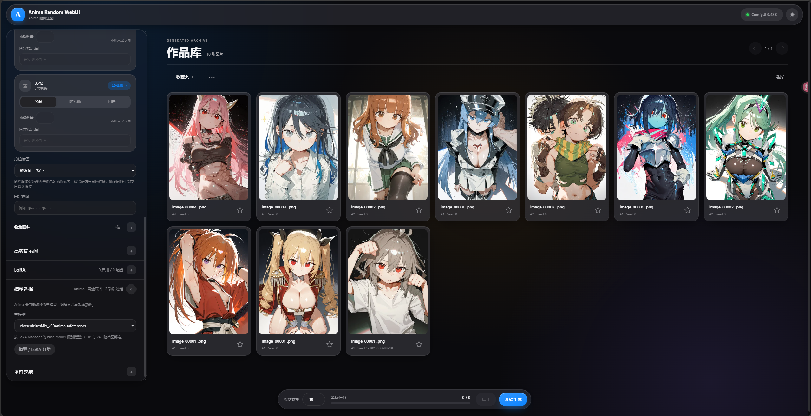

# Anima Random WebUI 0.1.1 · New Beginning

**纯粹、轻量的 Anima 随机生图工作台。**

Anima Random WebUI 连接已有的本机 ComfyUI，让你固定喜欢的角色与画风，再通过服装、姿势、背景和表情的随机组合寻找灵感。

本项目是 [Comfy Image Atelier](https://github.com/159159pzy-crypto/comfy-Image-Atelier) 的精简分支，剔除了 Krea 2、单图工作台、图生图、AI 助手、图片反推和 EXE 启动器等功能，专注于 Anima 随机生图。

*截图中的作品、模型和 LoRA 为使用示例，不随下载包提供。*

## 可以用它做什么

- **控制随机范围**：人物、服装、姿势、背景、表情五个词池分别固定或随机，支持中文搜索、特征筛选、收藏及自定义词条导入。
- **连续探索不同组合**：每批最多生成 1000 张，支持任务排队和固定／随机图像种子。
- **搭配自己的画风**：浏览 LoRA 封面，管理权重与触发词，为人物绑定 LoRA，保存常用风格预设。
- **从底图到高清作品**：支持普通采样、双采样，以及 Sesqui、SeedVR2 等可选放大流程；按需要准备对应节点与模型。
- **沿着满意的结果继续创作**：原样复现、同词变体、局部重抽或按原设置继续抽取，并将作品整理进收藏夹。

## 下载与开始使用

下载 [**AnimaRandomWebUI-0.1.1-source.zip**](https://github.com/159159pzy-crypto/comfyui-random-image-generation/releases/download/anima-webui-v0.1.1/AnimaRandomWebUI-0.1.1-source.zip)，完整解压后使用。

1. 准备 **Python 3.11+**，按 [README 安装指南](https://github.com/159159pzy-crypto/comfyui-random-image-generation#开始使用) 配好 ComfyUI、所需节点和模型，并单独启动 ComfyUI。
2. 在解压目录运行 `Install.ps1` 安装本项目，再按 README 的词库路径配置运行 `Start.ps1`；词库可自动发现时，也可双击 `Start.cmd`。
3. 浏览器打开 `http://127.0.0.1:8191`，选好模型与词池，开始生成。

本版采用源码运行，下载包不包含 Python、ComfyUI、模型或 EXE 启动器。节点安装、模型下载和推荐放大参数均在 README 中说明。已有用户升级前，请备份个人数据目录和 ComfyUI 原图。

[完整项目介绍与使用指南](https://github.com/159159pzy-crypto/comfyui-random-image-generation#readme) · [推荐放大链路](https://github.com/159159pzy-crypto/comfyui-random-image-generation#推荐放大链路) · [反馈问题](https://github.com/159159pzy-crypto/comfyui-random-image-generation/issues)
